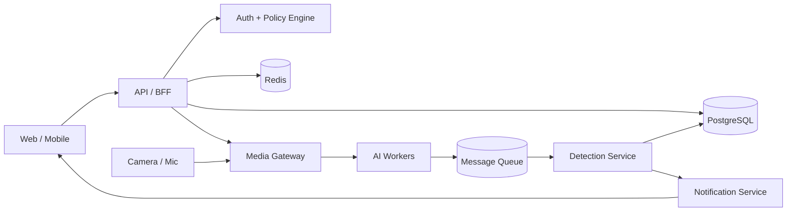

# 01. 시스템 아키텍처

## 책임 분리
1. **Identity**: 가입, 로그인, 토큰, 사용자 및 세션.
2. **Workspace / Authorization**: 개인·기관 조직, 멤버·시터 초대, 아동 접근 범위와 권한.
3. **Child**: 기본 프로필, 프로필 접근·수정 감사.
4. **Monitoring**: 스트림 접근 정책 및 모니터링 연결 상태.
5. **Detection**: 울음, 얼굴 가림 의심, 가장자리 접근, 움직임, 영상 장애 이벤트.
6. **Care**: 루틴, 울음 원인 후보, AI 행동 추천, 시도 행동 및 반응.
7. **Notification**: 위험 알림, 수신자 선택, 푸시, 읽음/확인, 전달 실패.
8. **Audit**: 민감 정보 조회, 초대, 권한 변경, 위험 상태 변경.

## 멀티테넌시 모델
- `workspace.type = PERSONAL | INSTITUTION`. 개인 계정 가입 시 PERSONAL 워크스페이스 생성.
- 사용자 1명은 복수 워크스페이스에 가입 가능. 예: 부모가 개인 공간 소유자이자 시설 직원일 수 있음.
- `child`는 전역 리소스. `workspace_child`가 아이를 특정 공간에 연결하며 승인·종료를 관리.
- 아이 프로필과 감지 이벤트는 `child_id`를 기준으로 관리하지만, `event.workspace_id`는 **이벤트 발생·관리 주체의 공간**으로 고정.
- 기관이 연결을 해제해도 개인 공간의 기록이나 다른 공간의 이벤트에 접근할 수 없음.
- 모든 데이터 쿼리에는 `workspace_id`와 검증된 `child_id` 범위를 적용. 클라이언트 제공 ID만 신뢰하지 않음.

## 권장 구성

## 이벤트 흐름
1. AI 워커는 `source_id, child_id, workspace_id, timestamp, model_version, confidence` 포함한 내부 감지 결과를 보냄.
2. Detection 서비스는 중복 제거, 시계열 이벤트 통합, 신뢰성 평가 후 DB 기록.
3. 트랜잭션에서 이벤트 + outbox를 함께 기록; 비동기 작업자가 권한별 수신자에게 알림 전파.
4. 사용자가 확인한 후에도 점검 결과(`resolution`)가 제출되지 않으면 상태는 해결되지 않음.
5. 울음 감지 시 추천 요청을 별도 큐에 등록; 지연·실패 시 일반적인 안전 확인 문구 표시.

## 소유/공유 경계
- 서로 다른 워크스페이스 간 자동 데이터 공유 금지.
- 개인의 기록을 기관에 공유하려면 `data_share_grant`에 대상 공간, 아동, 데이터 범위, 만료 시간, 부여 주체와 근거 기록.
- 동일 아동이 두 공간에 연결돼도 이벤트가 자동 병합되거나 전역 공유되지 않는다.
