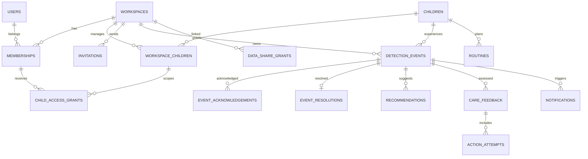

# 02. DB 논리 모델

## 관계

## 주요 엔터티
| 테이블 | 핵심 칼럼 | 특징 |
|---|---|---|
| `users` | id, email, password_hash, status, created_at | email 고유, 비밀번호 Argon2id 등 |
| `user_sessions` | id, user_id, token_hash, expires_at, revoked_at | 갱신 토큰은 해시만 보관 |
| `workspaces` | id, type, name, status, created_at | PERSONAL/INSTITUTION |
| `memberships` | id, workspace_id, user_id, role, status | owner/admin/guardian/sitter/staff/viewer |
| `children` | id, display_name, birth_date, photo_object_key, created_at | 최소 정보 보관 |
| `workspace_children` | id, workspace_id, child_id, link_status, created_at, ended_at | 유효한 아이-공간 관계 |
| `child_access_grants` | id, workspace_child_id, membership_id, capabilities(jsonb), valid_from, valid_until, revoked_at | 아이별 최소 권한 |
| `invitations` | id, workspace_id, invited_email_hash, target_role, token_hash, expires_at, accepted_at, revoked_at | 단발 사용 |
| `invitation_child_scopes` | invitation_id, workspace_child_id, capabilities | 수락 후 접근권한 초기화 |
| `data_share_grants` | id, child_id, from_workspace_id, to_workspace_id, scopes(jsonb), consent_ref, expires_at, revoked_at | 공간 간 명시적 공유 |
| `devices` | id, workspace_id, child_id, device_type, state, last_seen_at | 별도 카메라 온보딩 UI 불필요 |
| `monitoring_sessions` | id, workspace_id, child_id, source_id, status, started_at, ended_at | `live/offline/unverifiable` |
| `sensor_readings` | id, device_id, metric, value, unit, observed_at | 센서 미연결은 값 생성 금지 |
| `detection_events` | id, workspace_id, child_id, source_id, type, severity, status, started_at, ended_at, verifiable, model_version, confidence, summary | 상태 이력은 별도 로그 |
| `event_status_history` | id, event_id, from_status, to_status, actor_id, reason, created_at | 변경 감사 |
| `event_acknowledgements` | id, event_id, membership_id, acknowledged_at | 사용자별 확인 |
| `event_resolutions` | id, event_id, membership_id, result, note, resolved_at | 실제 확인 결과 |
| `cause_candidates` | id, event_id, cause_key, rank, score, reason | AI 추정, 진단 금지 |
| `recommendations` | id, event_id, action_key, title, explanation, instructions(jsonb), priority, model_version | 생성 시점 고정 |
| `care_feedback` | id, event_id, membership_id, response, note, created_at, idempotency_key | 중복 제출 방지 |
| `action_attempts` | id, feedback_id, recommendation_id, action_state, note | 시도/미시도 기록 |
| `routines` | id, workspace_id, child_id, type, title, scheduled_at, status, completed_at, created_by | 수면/기상/놀이/달래기/기타 |
| `notifications` | id, event_id, recipient_membership_id, channel, delivery_status, read_at, sent_at | 수신자별 |
| `notification_preferences` | membership_id, channel, sound_enabled, enabled | 위험 알림 정책은 서버에서 강제 |
| `audit_logs` | id, workspace_id, actor_user_id, action, object_type, object_id, metadata, created_at | 보안 로그 |
| `outbox_messages` | id, topic, aggregate_id, payload, published_at, retry_count | 이벤트 안전 전파 |

## DB 제약
- 대부분의 ID는 UUID, 시간은 UTC `timestamptz`; API에서 ISO 8601 반환.
- FK로 참조 무결성 확보. 액션/피드백 이벤트는 반드시 `cry` 타입 확인(서비스 계층 또는 DB 트리거).
- `UNIQUE(workspace_id,user_id)` on memberships; 활성 링크 중복 방지 부분 인덱스.
- `UNIQUE(event_id,membership_id)` on event_acknowledgements.
- `UNIQUE(membership_id,idempotency_key)` on care_feedback.
- `(workspace_id, child_id, started_at DESC)` 등 복합 인덱스, 인덱스 상세는 `12-example-sql.md`.
- 삭제 시 위험 이벤트/감사 기록은 보존 정책 적용. 무조건 연쇄삭제하지 않음.
